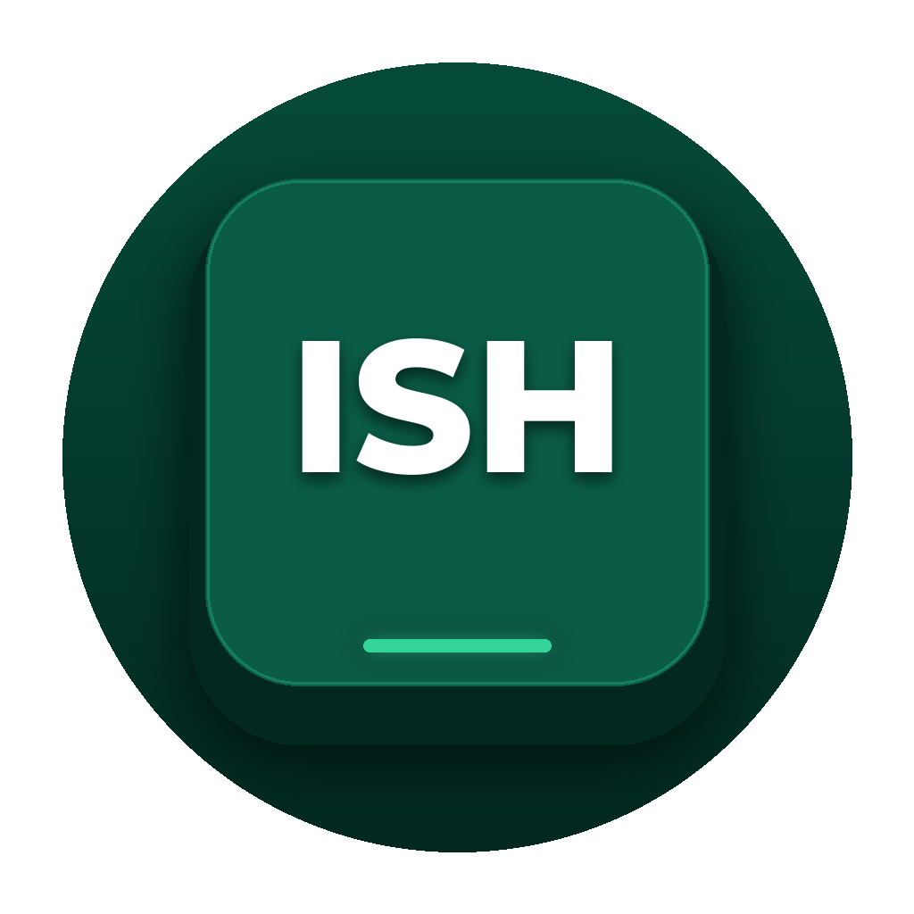

# ISH Keyboard (Internet Standard Hmar)

<p align="center">
  
</p>

<p align="center">
  <strong>Official Modern Mobile & Desktop Keyboard for the Hmar Language</strong><br>
  <em>Engineered and Maintained by the Hmar Heritage Foundation (HHF)</em>
</p>

<p align="center">
  <a href="https://github.com/hmar-heritage-org/ish-keyboard/releases"></a>
  <a href="https://hmarheritage.pages.dev"></a>
  <a href="#"></a>
  <a href="#"></a>
  <a href="LICENSE"></a>
</p>

---

## 1. Overview

**ISH Keyboard** is a production-grade keyboard specifically crafted for Hmar speakers. It solves the historic conflict in digital Hmar communication between **QWERTY input speed** and **classical print orthography**, bringing intelligent morphosyntactic awareness, contextual n-gram prediction, and smart retroflex conversion to everyday mobile typing.

Built on top of the robust [Keyman Engine SDK](https://keyman.com/engine/), ISH Keyboard operates **100% offline with zero network permissions**. No keystrokes, personal messages, or typed text ever leave your device.

---

## 2. Key Features

### ⚡ Smart Retroflex Transformation
Type quickly using standard QWERTY characters—the engine seamlessly converts digraphs into classical retroflex letters:
* `th` + `r` $\to$ **`ṭh`** (*thra* $\to$ *ṭha*, *thrung* $\to$ *ṭhung*)
* `t` + `r` $\to$ **`ṭ`** (*trawng* $\to$ *ṭawng*, *tran* $\to$ *ṭan*)
* **Escape Sequence**: Tapping `r` once more instantly expands the retroflex back to literal `tr` or `thr`.

### 🧩 2-Slot Morphological Decoupling
To enforce the Internet Standard Hmar (ISH) orthography—which standardizes free pronominal particles and clitics—the keyboard detects fused compounds in real time and renders an unambiguous **2-Slot Banner**:
* **Slot 1 (Left - Literal Override)**: Displays the exact typed form (e.g. `[ anih ]`).
* **Slot 2 (Right - Canonical ISH)**: Displays the standardized split form (e.g. `[ a nih ]`).
* Tapping space accepts the canonical ISH standard; tapping Slot 1 retains your literal fused input.

### ␣ Spacebar Auto-Split
Over **8,336 verified lexical compounds** and dynamic clitic patterns automatically split upon hitting the spacebar:
* **Pronominal Verbal Prefixes**: `anih` $\to$ `a nih `, `kahung` $\to$ `ka hung `, `inih` $\to$ `i nih `, `kanfe` $\to$ `kan fe `
* **Plural & Size Markers**: `-hai` (`naupanghai` $\to$ `naupang hai `), `-te` (`nute` $\to$ `nu te `), `-chal`, `-pui`, `-naw`, `-tak`, `-zie`, `-lem`
* **Preceding Whitespace Preservation**: Intelligent relative offset positioning ensures that preceding words and spaces are strictly protected (e.g., `ka hung anih ` $\to$ `ka hung a nih `).

### 🔮 Offline N-Gram Neural Transitions
Pre-loaded with **101,978 next-word phrase transitions** extracted from the foundation corpus, offering fluent multi-word prediction and intelligent suggestions.

### 📱 Ergonomic Companion App
* **Keyboard Height Slider**: Choose between Compact ($220\text{ dp}$), Normal ($275\text{ dp}$), Tall ($310\text{ dp}$), and Extra Tall ($360\text{ dp}$).
* **Built-in Orthography Guide**: Quick-reference guide explaining the 5 fundamental rules of Internet Standard Hmar.
* **Onboarding Assistant**: 2-tap activation and input method switching.

---

## 3. Repository Architecture

```
ISH-key/
├── android/                 # Android InputMethodService app project (Gradle + Keyman SDK)
│   ├── app/                 # Main application module
│   │   ├── src/main/java/   # Native IME service & companion activities
│   │   ├── src/main/assets/ # Packaged keyboard, lexical model & host scripts
│   │   └── src/main/res/    # Adaptive icons, layouts, and themes
│   └── build.gradle         # Android build and release signing config
├── engine/                  # Core Keyman keyboard source files
│   ├── hmar_ish.kmn         # Keyman keyboard definition & retroflex rules
│   ├── hmar_ish.keyman-touch-layout # Phone & tablet touch layout mapping
│   └── hmar_ish.kps         # Package specification for compilation
├── lexical_model/           # Lexical model source definition
│   └── hhf.hmr.ish/         # ISH dual-lexicon wordbreaker and trie sources
├── scripts/                 # Compilation & dataset processing scripts
│   └── compile_neural_lexical_model.py # Builds hybrid trie + n-gram runtime
├── resources/               # Orthography manifests, frequency lists, and cleaning data
│   ├── cleaning/            # Curated compound manifests (anchor, hai, te, chal, pui)
│   └── lexicon/             # Unigram and reference lexicon files
├── web/                     # Interactive browser-based test bench
└── docs/                    # Specification documentation and user guides
```

---

## 4. Building from Source

### Prerequisites
* **Java Development Kit (JDK)**: Version 17
* **Android SDK**: Build Tools 34.0.0, Compile SDK 34, Minimum SDK 21
* **Node.js**: Version 18+ and npm
* **Python**: Version 3.10+ (for model compilation)

### Step 1: Install Dependencies
```bash
cd ISH-key
npm install
```

### Step 2: Compile the Lexical Model
Fetches the latest n-gram transitions and builds the runtime model (`hhf.hmr.ish.model.js`):
```bash
python3 scripts/compile_neural_lexical_model.py
```

### Step 3: Build Keyman Keyboard Package
Compiles `.kmn` and `.kps` into `.kmx`, `.js`, and `.kmp`:
```bash
./node_modules/.bin/kmc build engine/hmar_ish.kmn engine/hmar_ish.kps
cp engine/hmar_ish.kmp android/app/src/main/assets/
cp engine/hmar_ish.js android/app/src/main/assets/packages/hmar_ish/
cp engine/hmar_ish.kmx android/app/src/main/assets/packages/hmar_ish/
```

### Step 4: Assemble Android Application
```bash
cd android

# Build debug APK:
./gradlew assembleDebug

# Build production signed APK:
./gradlew assembleRelease

# Build Google Play Bundle (.aab):
./gradlew bundleRelease
```
Compiled output binaries will be generated at:
* **Release APK**: `android/app/build/outputs/apk/release/app-release.apk`
* **Release AAB**: `android/app/build/outputs/bundle/release/app-release.aab`

---

## 5. Installation & Sideloading

1. Download the latest release from the [Releases](https://github.com/hmar-heritage-org/ish-keyboard/releases) page or from the [Hmar Heritage Foundation Website](https://hmarheritage.pages.dev).
2. Open the downloaded `.apk` on your Android device and confirm installation.
3. Launch **ISH Keyboard** from your app drawer.
4. Complete the 2-step setup:
   * **Step 1**: Tap *Enable in Settings* $\to$ Toggle on **ISH Keyboard**.
   * **Step 2**: Tap *Select ISH Keyboard* $\to$ Choose it as your active keyboard.

---

## 6. Privacy Policy & Security

* **Zero Network Access**: The keyboard does not declare the `android.permission.INTERNET` permission in its manifest. Keystroke telemetry, usage tracking, and data transmission are physically impossible.
* **No Cloud Storage**: Dictionary trie lookups, morphological auto-splitting, and n-gram suggestions execute strictly on-device in memory.

---

## 7. Community & Contribution

ISH Keyboard is developed and maintained by the **Hmar Heritage Foundation (HHF)** as part of the Hmar Open Language Initiative.

* **Website**: [hmarheritage.pages.dev](https://hmarheritage.pages.dev)
* **Organization**: [github.com/hmar-heritage-org](https://github.com/hmar-heritage-org)
* **Feedback & Issues**: Please open an issue on the [Issue Tracker](https://github.com/hmar-heritage-org/ish-keyboard/issues).

---

## 8. License

The ISH Keyboard layout, engine rules, and Android wrapper are open source licensed under the **[MIT License](LICENSE)**. Keyman Engine SDK is copyright © SIL International under the MIT License.
